# applytracker · 秋招投递进度看板

一边投简历一边丢记录，是这个项目要解决的问题。

在公司官网上点完「提交申请」，浏览器扩展认出「投递成功」，顺手把**公司名、岗位、网页链接、投递时间**记进你本机的 CSV；打开看板就是一条条投递记录，状态在表格里直接改。另一个标签页读**邮箱通知**（`qqmail2table` 是一个把邮箱通知写进表格的配套小工具，可选 —— 不装它也能用，看板自己就能读你的邮箱、或一份现成的 CSV，见下面「[接上邮箱通知](#4-接上邮箱通知可选)」那节），**按公司名自动跟投递记录对上**——投了哪几家、哪家来消息了，一眼看得出。这一页有**两个可切换的视图**：`面试测评截止`（通知本身 + 三个数 + 一块分布 + 一整排筛选）和 `投递进度`（每家公司一条进度条 —— 走到测评 / 一面 / 二面 / 终面 / offer 的哪一轮，没到的折成一个灰块，点一下就能往前推）。第三个标签页是**机会库**：把别人整理好的校招汇总表（几千条企业 + 岗位 + 截止时间）搬进来，按行业 / 城市 / 批次筛，只看还没截止的。

全程在自己电脑上，零账号、零依赖（只用 Python 标准库）。配色有**自动 / 浅色 / 深色**三档，默认跟随系统。

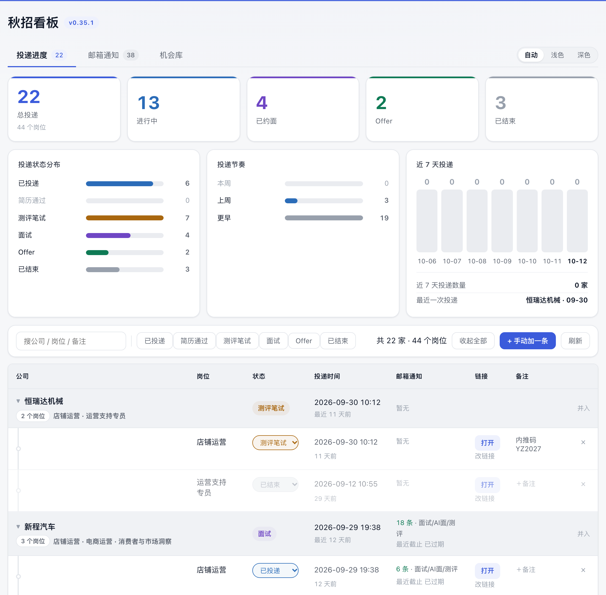

## 让 AI 帮你装（最省事的一条路）

仓库根目录放了一份给 AI 看的说明书 [`AGENTS.md`](AGENTS.md)。把你平时用的 AI 打开（WorkBuddy / Claude Code / Cursor / Codex 等，**只要它能在这台电脑上执行终端命令**），把下面这整段原样发给它：

```text
帮我在本机把这个项目跑起来：https://github.com/mengyingxiong43/campus-job-board

要求：
1. 先 clone（或下载 ZIP 解压）到一个合适的目录，然后**先读根目录的 AGENTS.md**，
   按它「跑起来」那一节做。
2. 不要改任何代码，也不要装 Python 第三方包 —— 这个项目零依赖，只要本机有 Python 3.9+。
3. 起服务后，用 curl -s http://127.0.0.1:8788/api/health 确认返回里带 "ok": true，
   再把 http://127.0.0.1:8788/ 打开给我看。
4. 如果我想用它记投递记录，再教我把 extension/ 这个浏览器扩展装上（AGENTS.md 里有步骤）。
5. 任何一步做不下去，把原始报错原文贴给我，不要自己猜着改代码。
```

**它会做什么**：拉代码 → 起服务 → 把看板打开。**你不用给任何账号、密码、授权码** —— 全程只在本机操作，服务也只监听 `127.0.0.1`。

**不装扩展也能用**：看板打开就能看，机会库随包带 9381 条岗位（首次启动自动导入，不用你做什么）。扩展只是让你在招聘网站点完「提交申请」时，自动记一条投递记录。

**想自己手动装**：看下面「[快速开始](#快速开始)」。

## 三个标签页

**配色在标签栏右端，三档**：`自动 / 浅色 / 深色`。默认「自动」跟着系统走（macOS 白天黑夜自动切换，这里跟着变）；手动选了哪一档就记在这台浏览器里，刷新、关掉再开还是它，想回到跟随系统点「自动」。深色不只是换个底色：原生控件（下拉框、滚动条、输入框的清除钮）一起变，**铺在强调色上的字会自动换成深色**（深色下强调色本身是浅蓝，配白字看不清）。

**邮箱页是两个可切换的视图**：`面试测评截止` 是那张通知表（三个数、类型分布、一整排筛选、按截止时间排），`投递进度` 按公司一家一行画进度条（**只停在测评阶段的不列，挂了的除外**；上面能按环节 / 按「已止步」筛）。切换按钮就在页面最上面，上次停在哪一版，下次打开就直接是哪一版（详见下面「[邮箱通知](#邮箱通知--从你邮箱里抓的)」那节）。

**投递进度** — 你手动投过的每一家

- 顶部五个数：总投递、进行中、已约面、Offer、已结束 —— **都按公司算**（一家公司就是一个「投递」，岗位数写在「总投递」的副标里）
- **同一家公司投了多个岗位的，会折叠到公司那一行下面**：主行给这家投了几个岗位、整体进度（组里最靠后的那个状态）、最近一次投递、收到的通知汇总；**点这一行任何位置**（不用去戳最左边那个小三角）就展开，看每个岗位各自的状态、备注、链接。默认收起（一屏先看清一共投了几家），右上角「展开全部 / 收起全部」能一键摊开，单家的展开也会记住
  - 同一家的不同写法会认成一家：`恒瑞达机械` / `深圳市恒瑞达机械有限公司` / `星桥科技（中国）有限公司` 都归到一组。规则只做最保守的三步（去括号备注 → 去公司组织形式后缀 → 去开头的省 / 市），**不做"一个名字包含另一个就算同一家"**（那会把「长河银行」和「长河银行保险」并掉）
  - 搜索时命中的那几家会自动摊开 —— 不然只剩一个公司名，看不出命中的是哪个岗位
- **子公司可以收到主公司下面**：像 `示例五局` / `示例南洋` / `示例国际城市开发有限公司` 这种，收进 `示例建筑集团` 一行底下 —— 主行写着「N 家子公司 · N 个岗位」，点开是各家子公司，投了多个岗位的那家还能再点开看每个岗位。**归并关系是你自己点 / 拖的，程序不猜**：同一张表里既有该并成一家的大集团，也会碰上名字像、其实是两家不相干公司的（`示例家居` 跟 `示例家居集团`），按名字前缀自动并一定出错。所以只认你操作过的那条，存在本机 `data/app_parents.json`
  - **直接拖**（最省事）：把一家公司那一行**拖到另一家公司那一行上**，松手就并过去 —— 拖着的时候落点那行会亮一圈（能拖的行光标是「张手」）。已经建好主公司之后，剩下几家挨个拖上去就行，不用反复填同一个名字。拖到自己身上、或者拖回自己下面的子公司上（会绕成环）都不会生效
  - 或者点表格最右边那颗「**并入**」开个框填主公司名（候选里挑一个、或者现打一个新的都行）—— 表里**还没有**的名字（比如第一次建「示例建筑集团」）就得用它
  - 已归并的那颗按钮变成「**拆出**」，点开面板里有「不并了」，一按就散回原样（**把输入框清空 = 什么都不改**，免得点走一步就把归并抹了）
  - 主公司那行**自己也带一颗「并入」** —— 主公司名打错了不用把子公司一个个拆出来重并，直接在它那行改挂到对的名字下面；上溯是多级的，`示例五局 → 示例建筑集团 → 示例控股` 也走得通
  - 计数两个口径都在：KPI 和行徽标上的「家」按**归并后剩几行**算（跟你一行行数出来的数一致），鼠标停在「近 7 天投递」那块面板底下那两行上，还能看到原始的「涉及公司 N 家」和「已归并子公司 N 家」
- 投递状态分布、投递节奏（本周 / 上周 / 更早）、**近 7 天投递趋势图**（v0.34.0 起；今天在最右边那根，柱子高矮一眼看出哪天投得多，鼠标停在柱子上能看到那天投了哪几家）。图底下只留两行 —— **近 7 天投递数量**和**最近一次投递**；其余几个数（涉及几家公司、投了几个岗位、平均已投天数、有几家收到过通知、有几家并过子公司）鼠标停在那两行上就看得见（v0.34.1 起，柱子也加高了一倍）
- 按公司 / 岗位 / 备注搜索，按状态筛选（**搜索词、状态筛选、哪几家展开了都会记住**，刷新、关掉再开都还在）
- **表格里每一格都能点着改**：公司名、岗位名、投递时间、链接、备注、状态，改完立刻写回 CSV，没有"保存"这一步（Enter 存、Esc 撤、点到别处也算存）。鼠标移到能改的格子上会浮出一张描了蓝边的白底小片，告诉你这里能点。**点开的输入框是浮在格子上面的**（原内容还占着位），所以编辑时整张表一个像素都不会动 —— 早先那版是就地塞个输入框进去，一点编辑列宽就互相挤、几十行文字跟着重新换行
  - **公司名 / 岗位名**点一下变输入框 —— 扩展把公司名认错的时候，直接在看板上改回正确的名字就行
  - **投递时间**点一下出系统的时间选择器（只写到分钟）；**本来就是空的那格会预填今天**，右边还给「**今天 / 昨天 / 前天**」三个快捷按钮 —— 点一下直接存，不用点日历也不用敲键盘。老记录里只写了日期的也能改；原值带着钟点的（`15:41` 这种）点快捷键只换日期、钟点留着
  - **链接**那一格平时是「打开」，下面一行淡淡写着「改链接」，点它就地改；本来没链接的显示「＋链接」。点开的输入框是**浮在格子上面的**，整张表一动不动（链接列只有 72px，"打开"胶囊一摆就满了，编辑框要是去挤那一行，整表的文字会被挤得重新换行）
  - **改完名字，跟飞书同步不会认不出这条**：改名时旧名字会记在本机 `data/app_renames.json` 里，下次同步照样对得上，不会因为改过名就在看板上多出一条重复记录
  - 公司名**不许清空**（空着那行会被当成无效记录跳过），改成一个空值会被直接拒掉
  - 「邮箱通知」那一列是跟邮箱看板按公司名配对算出来的，**改不了** —— 要改的是那封邮件本身
- 每行的「邮箱通知」列显示这家公司来过几条消息、最先到期的是哪个
- **进度可以跟飞书表格同步**：表格里改了状态，看板过一会儿自己就变；**刚投完切过来看也不用等**（页面一露面就会顺手同步一次，见下面「[跟飞书表格里的投递进度保持同步](#跟飞书表格里的投递进度保持同步可选)」）。工具栏上那个「同步飞书进度」按钮能立刻拉一次
- **页面知道自己是不是旧代码**：升级了程序之后，你那个开着没关的标签页不用手动硬刷新 —— 页脚那行版本只在打开时渲染一次，所以改由页面自己核对（每次轮询都带回服务端当前版本）：对不上就在右下角亮出「看板已更新到 vX，点这里刷新」，**只要你没在敲东西**就自动刷一次，滚动位置也放回去；正在改某一格的时候绝不刷，免得把你敲进去的吞掉

**邮箱通知** — 从你邮箱里抓的

这一页是**两个可切换的视图**，最上面一行就是那两个按钮，右边写着你现在的处境（「共 N 条通知 · M 条还没处理」）。上次停在哪一版，下次打开就直接是哪一版。

#### 视图一：面试测评截止

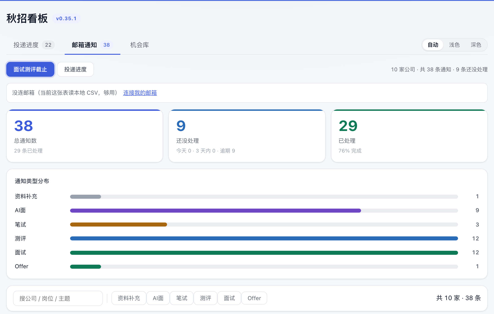

邮箱通知本身。**顶部只有三个数**（总通知数 / 还没处理 / 已处理）+ **一块分布**（通知类型）—— 今天截止、3 天内、逾期这几个数并进了「还没处理」那张卡的副标里，不再各占一张卡。

- 数据源两种：直接从飞书多维表格读，或者读 qqmail2table 生成的 CSV
- **默认按紧急程度排**：截止时间已过还没处理的最上面，往下今天 / 3 天内 / 一周内 / 一周以上 / 截止时间没识别出来，**已经处理掉的全部沉到最后**，每段带一个小标题和条数
- 想换个看法：`按截止时间`（平铺，不分段）、`按公司`；还有「隐藏已处理」「只看没处理的」「只看紧急的」三个开关
- 搜索词、通知类型、排序、那几个开关也都会记住（跟另外两页一样，刷新 / 关掉再开都还在）
- **筛完一条都没有的时候，表里会写着「当前筛着 …」，并给一颗「清除全部筛选」** —— 筛选是会被记住的，过两天回来想不起自己还点着某个类型标签，就会看到一张空表；光写「试试清除筛选」看不出是哪个条件在起作用。计数行也会把生效条件带出来
- **「按公司归纳」形态下，沉底的那批前面有一条「已经处理掉的」分隔条**（写明家数与条数），不用一路滚下去猜灰字是从哪儿开始的
- **标了「已完成」、但截止时间还没到的那几条，会单独列成一段「标了已完成、但截止还没到」**（排在那条灰色分隔条之前，橙色，照常报还剩几天）：「已完成」在这里是「我看过了 / 我处理了」，不等于「这件事在时间上已经结束」。如果一条通知你标了已完成、但它写着的截止时间还没过，它不会被当成「不用管了」沉到灰区去 —— 那正是最容易错过的一撮。这个数同时会出现在「已处理」那张卡的副标和右上角的处境说明里
- 「处理」列是下拉框：待处理 / 已完成 / 已过期 / 已忽略。改完立刻生效，存在本机 `data/notice_states.json`
- **标成「已完成 / 已过期 / 已忽略」的，那一行的「距截止」就不再报还剩几天，只画一个破折号** —— 事情都做完了还挂着「过期 21 天」只是噪音。它们同时也不计入「还没处理」，只会沉到表格最后。**唯一的例外就是上面那条**：截止时间还没到的，照常报剩余天数
- 手动标的状态不会被飞书同步冲掉；下拉里选「（清除我的标记）」就回到飞书原来的值
- 「投递状态」列按公司名跟投递记录对上，没投过的显示"没投过"
- 飞书数据源每 5 分钟最多同步一次，页面每 10 秒重读本地缓存；CSV 数据源则随文件更新

表格里分组标题、紧迫度色带、处理状态的颜色都跟着数据走，扫一眼就知道该先处理哪条：

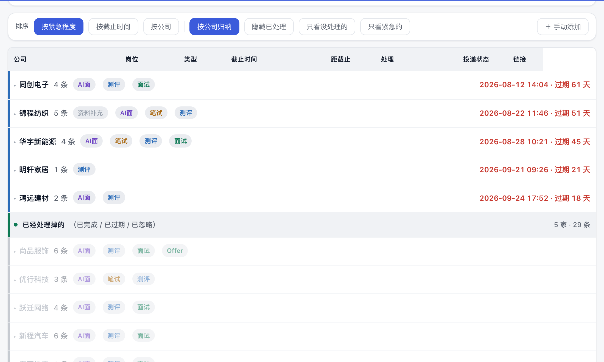

深色模式下是这套样子（在标签栏右端切，也能一直跟着系统走）：

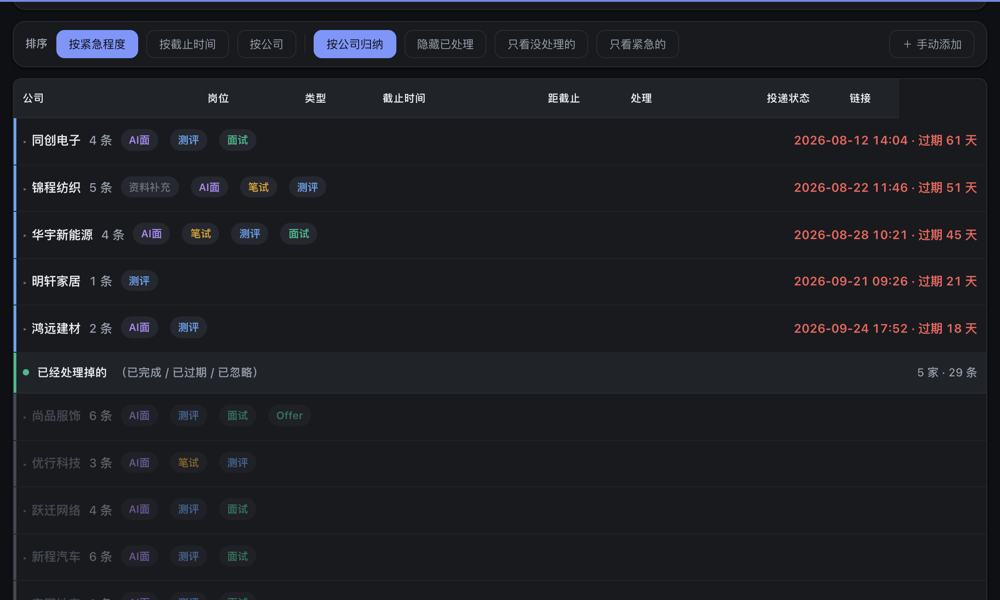

#### 视图二：投递进度

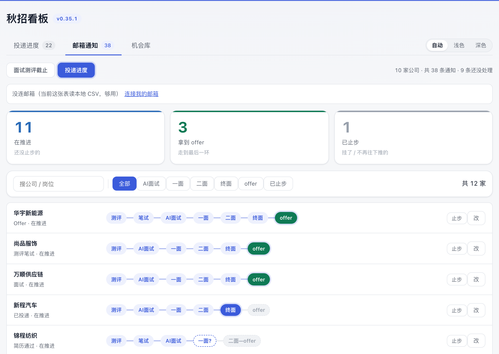

每家公司一条进度条，走到哪一轮一眼看得见；上面三个数：在推进 / 拿到 offer / 已止步。

- **走得最远的排最前面**（拿到 offer 的、面到终面的先看见），止步的一律沉到最后
- **只停在「测评」阶段、还没约到面试的公司不列** —— 这一版是拿来看面试进展的，一堆「还在测评」的混在里面等于没有重点。**但挂掉的不受这条管**：半路挂了的（哪怕就停在测评）一定会列出来 —— 挂了这件事，得让人看得见。
- 按**公司**一家一行（不是按通知行），所以同一家来了三封面试邮件也只画一根
- **点公司名 → 切回「面试测评截止」并只看这一家**
- **上面那排筛选**：搜索框（公司 / 岗位）、按现在停在哪个环节筛（全部 / 测评 / 笔试 / AI面试 / 一面 / …）、一键「已止步」。**选过哪一档会记住**，下次打开还是它

进度条本身：

- 三种样式分清三件事：**已过的环节**浅蓝底、**当前环节**实心蓝（拿到 offer 是绿的）、**还没到的**折成一个灰块
- 还没到的环节不管有几个，都折成**一个**灰块，写着「下一环节—offer」（只剩一个就直接写它）—— 一眼知道还差几轮。**还剩几档写在灰块的悬停提示里**（折叠过了，数格数没用）
- **节点不固定，各家不同**：默认按 测评 → AI面 → 一面 → 二面 → 终面 → offer 排；点行末的「改」用「、」隔开写你自己那套（比如「测评、群面、HR面、offer」），顺序按标准次序自动理，认不出的环节不会丢
- 当前走到哪是**从邮件里读的**：主题里出现「初试 / 复试 / 终面」这类词就往前推一格；邮件没写第几轮、只能看出是面试的，那一档会打成**虚线描边 + 问号**（待确认），点一下改成实际轮次
- **想手动往前推就点后面那些环节**（灰块自己也写着要点到哪一轮）；点已经走过的环节也能把当前退回那一格
- **不顺了就点右边「止步」**：后面那一截不再显示、这家沉到最后，**进度条末尾挂一个红底「已挂」**，也不计入「在推进 N 家」（留个记录，免得每次看都在想"这家到底挂了没"）。点「继续」就能重新算在推进
- 止步的行整行淡下去，但**那个红「已挂」标不跟着淡** —— 一块列表里就它是实心红，挂了的扫一眼就能挑出来（淡下去恰恰是看不见的做法）
- 止步有两个来源：**你自己点的**（行上有「继续」按钮），和**投递表里这家全部记录都标了「已结束」**自动算的（这时只写一行「投递表已结束」、不给「继续」—— 想恢复就去投递表把状态改回来，免得两处对不上）
- 节点不固定、来源分「自动推断」和「手动改过」两种；手改过想回到自动，点「改」里的「恢复自动」；数据存在本机 `data/interview_progress.json`（只有你动过手才会有这个文件）
- **录用 / 拒信是照主题读的，不读正文**（v0.33.7 起）：主题里写明「录用通知 / 意向书 / 入职 / 三方协议」这类录用文书的，才判录用；主题像「简历已收到 / 简历接收函 / 感谢投递」的一票否决。**正文里出现「录用」或英文 offer 一律不算**——页脚、退订链接、模板段落里全是这两个字，早期版本因此把测评邀请、投递回执都判成了「录用」
- **自动改状态前会先看旁证**：主题只写了「录用 / 录取 / offer」这种弱词时，**这家得先有过测评 / 笔试 / AI面 / 面试类通知**才推状态（真录用了，前面几封面试通知不可能一封都没有）。没有旁证就只把「依据」挂在那行上给你看，状态留给你自己点
- **「关联通知」列不是按名字随便并的**（v0.33.8 起）：两家只有**名字确实是同一个主体**才挂到一起 —— 「泰康集团 ↔ 泰康人寿」「建发集团 ↔ 建发股份」算同一家；而 **「京东」和「京东方」是两家完全不同的公司**，仅仅因为「京东」两个字是「京东方」的前两个字就被并到一起，是错的（短名只有两个字时，长名必须多出两个字以上才算同一家）

**机会库** — 别人整理好的岗位汇总表，搬到看板上筛

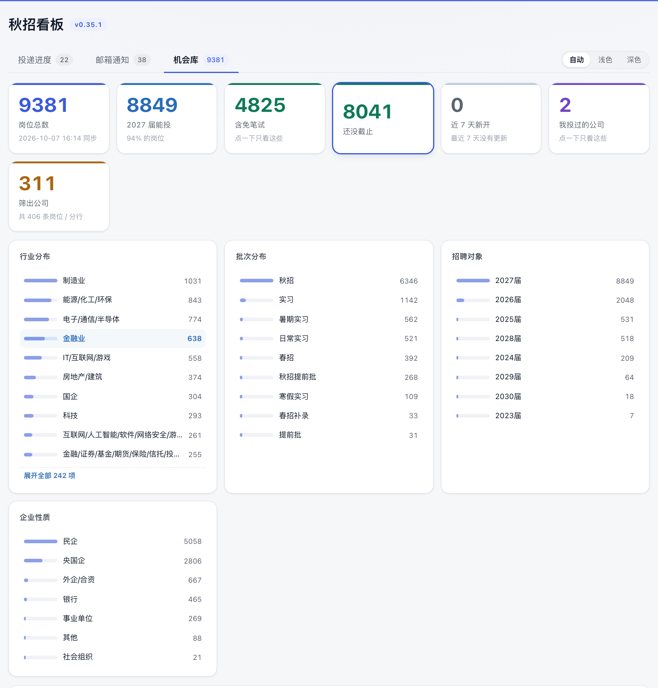

- 数据源是一张飞书多维表格。**源表 14 个字段一个不落地同步过来**：公司名称、行业大类、企业性质、招聘对象、批次、笔试/测评、工作地点、截止时间、更新时间、投递方式、官方公告、招聘岗位、备注/提示（外加记录 ID）
- 顶部七个数：岗位总数、2027 届能投、含免笔试、还没截止、**近 7 天新开**、我投过的公司、当前筛出多少。**每张卡点一下就筛选**
- **一家公司只占一行**：源表把一家公司拆成很多条 —— 中国邮政储蓄银行 30 多个「XX 省/市分行」、招商银行 50 多个、中信期货 40 多个分公司，一条一行的话整页全是同一家公司的名字。所以列表**按公司并过了**：主行写着「N 个分行 / N 个岗位」，第二行是各分行 / 岗位的短名，前面一个小三角（`▶` / `▼`），**这一行整行都能点**，点一下摊开看每一条、再点收起。地点列合并了这家全部分行，截止时间取**最近的一个还没过期的**（先投这个）。只有一条的公司照旧单铺一行，不套折叠壳
- **归并是在服务端做的**（先按公司分组、再对「公司」排序分页），所以翻页**不会把同一家劈到两页上**；「再看 60 家」也是按家翻。子品牌不会被并进去：`招商银行·招银网络科技`、`招商银行信用卡`、`招商银行第 10 季数字金融训练营` 各占一行，跟「招商银行」分开
- **表格里每个标签都能点**：公司名、行业、地点、招聘对象、企业性质、批次、笔试，点一下按它筛，再点一下取消（**点标签只筛、不会顺手把这家摊开**）
- 每行最后的 `⌄` 展开这一条的**全部字段**，里面的标签同样能点着筛
- 四块分布面板（行业 / 批次 / 招聘对象 / 企业性质），一条一行。面板只铺前 10 项，底下有「**展开全部 N 项**」，全表取值一个不缺
- **搜索分「包含」和「不含」两块，同时生效，每块都能挂好几条条件**：每条条件都是「先选字段、再填词」，右边 `＋` 加一条、`×` 删一条。包含里的词必须**都**出现（空格分隔多个词）；不含里的词出现**任何一个**就把这条整条排掉。举个例子——包含「行业 = 金融业」+ 包含「城市 = 广州」，再挂一条不含「城市 = 深圳」，三个条件一起算，词只会落在你选的那个字段里，不会串到别的字段去。字段留「全部字段」就是整条记录都搜（公司 / 岗位 / 行业 / 城市 / 企业性质 / 招聘对象 / 批次 / 备注 / 免笔试 / 截止时间 / 更新时间）。不含那一侧的字段框和输入框只要用了就**变红**，一眼能看出这是排除条件。条件挂多了、窗口又窄的时候，行会**自己往下换行**——一条条件里的「字段框 + 输入框 + `×`」永远是一整套、不会挤成一团
- 右下角的计数同时说清**两个口径**：`筛出 N 家（K 条岗位）` —— **N 是这张表里现在一行一行数得出来的公司数，K 是这些公司底下的记录条数**；一个筛选都没在拦的时候写 `共 N 家公司 · K 条岗位`。两个数都要有，只报一个必然有人觉得对不上（归并前 K 就是行数，归并后行数只有 N）
- **三个标签页的筛选条件都会记住**：搜索词（包含/不含每一条）、四个下拉、只看还没截止、「最近新开」档位、排序，连「再看 60 条」翻到第几屏，都存在浏览器 localStorage 里，**刷新页面、关掉再开都还是上次的条件**；点各页的「清除筛选」清空后，记住的也是空状态。页脚右下角有一枚小标写着「筛选条件已记住」；它要是变成红色的「本浏览器不记筛选」，说明这个浏览器不让网页存本地数据（隐私模式 / 站点数据被禁），筛选刷新后会丢。另外：**同一网站开两个标签页时两边共用一份存档**，后动的那页会盖掉前一页存的筛选
- **「最近新开」**：点一下按钮换一档，转一圈是 **7 天内 → 3 天内 → 今天 → 关闭**，只看最近有动静的岗位。开着的时候排序会自动切到「按更新时间」，最新的排最上面；公司名右边冒出 `今天 / 1天前 / 2天前 / 3天前` 的小标，就说明这条最近动过。**口径是源表的「更新时间」**——新开的岗位必然在里面，被重新编辑过的老岗位也会进来（想精确到"新出现"得靠每天比对，暂时没做）
- **排序四条规则**（截止时间 / 更新时间 / 公司名 / 行业），右边的 `↑正序 / ↓反序` 可以把任何一条反过来
- 默认「只看还没截止」，按截止时间从近到远排；「招满为止」这类认不出日期的不算逾期，但永远沉到最后
- 「我投过的公司」= 把这张表跟你的投递记录按公司名模糊配对，看看哪家其实也在招
- 「投递入口」通常就是网申链接，点进去投完，扩展照常把这条记进「投递进度」
- 表有几千上万条，所以**切到这个标签页时才去取数据**，一次 60 家（含底下的分行 / 岗位），「再看 60 家」往下翻
- **源表每天都在更新，看板会自己跟上**：本地服务一开着就有一个后台线程盯着它，超过 **6 小时**没同步就自己拉一次飞书（**不用点开这个标签页、也不用等**）；想立刻拉最新的点「**检查更新**」，也可以命令行 `python3 applytracker.py --opps-sync`（全量十几页、一分钟上下）。同步失败不会按满 6 小时记，10 分钟后会自己重试

关于源表里两处不规整的地方，看板是按下面的口径处理的（改不了源表，只能在自己这边收口）：

- **地点**：源表有两列，「地点②-筛地点选这里」是公式列、把多个城市拼成一条，有的行用逗号（`北京,苏州,上海`）、有的行用空格（`广州 深圳`），两种都按分隔符切开；另一列「工作地点（筛选不要选这列）」的每个选项本身就是一个城市串（`北京 上海 深圳 香港 台北`），只在公式列为空时兜底
- **企业性质**：源表里「民企 / 民营企业 / 私企」这类是同义的不同写法。筛选项按央国企 / 银行 / 外企·合资 / 民企 / 事业单位 / 社会组织 / 其他归并成一条，**表格和展开行里显示的仍是原表的原话**

三个标签页在地址栏里都有对应的锚点（`#apps` / `#notices` / `#opps`），刷新之后会停在你刚才那一页，也可以直接把链接存成书签。

## 快速开始

### 1. 起看板

```bash
cp config.example.ini config.ini
python3 applytracker.py --serve
```

macOS 双击 `start.command`、Windows 双击 `start.bat` 也一样。浏览器会自动打开 <http://127.0.0.1:8788/>。

第一次打开是空的，正常。

#### macOS 开机自启（可选）

双击 **`开机自启.command`** 就行。它会自己找 python 和 node、先跑一遍自检、把 plist 写到
`~/Library/LaunchAgents/`、注册进系统，最后做一次健康检查告诉你成没成。想取消就双击
**`关闭开机自启.command`**。

之后**每次登录自动在后台起服务**，崩了系统会拉起来（KeepAlive），不用开终端窗口。
装了自启之后再双击 `start.command`，它会发现服务已经在跑，直接帮你打开浏览器 —— 不会起第二个。

> ⚠️ **这一步必须在 Terminal.app 里跑**（双击 `.command` 就是在 Terminal 里跑）。
> 从别的进程、脚本或 CI 里调 `launchctl bootstrap` / `launchctl load` 会报
> `Bootstrap failed: 5: Input/output error`：它需要跟当前登录用户的**图形会话**通信，
> 没有会话就一律拒绝。所以别把这两条命令抄进自己的自动化脚本里，那样不会成功。

脚本还替你挡了两个坑：**8788 端口被占时问你要不要腾出来**（手动起过的进程会让新的起不来，
然后 KeepAlive 反复重启刷日志），以及**自检不通过就直接退出不装**（省得装完是个坏的）。

plist 里的三处路径都由脚本自动探测填入（python、项目目录、PATH 里 node 的位置），不用手改。
其中 node 那行别删 —— launchd 默认 PATH 里没有 node，而飞书同步用的 `lark-cli` 是
`#!/usr/bin/env node`，不带 node 会**静默**起不来（服务活着、数据不更新）。

不过也别指望那行一直有效：**node 升级换了目录，写死的老路径就废了**，而服务照常活着、
页面照常能开，只有飞书同步从此一条不进（实测踩过一次：node 从 `22.22.2-3` 换成 `22.22.2-5`，
plist 里还指着老的，于是飞书那边记的投递、通知全都没同步过来，看板上看着像"根本没记"）。
所以 `applytracker.py` 里 `_lark_env()` 会自己找一个含 `node` 的目录补进 PATH（`_node_dir()`），
不再依赖外部 PATH 写对。

想确认到底挂上没：

```bash
launchctl print gui/$UID/com.applytracker.server | grep -E "state|pid|runs"
# 要看到 state = running 才算真的挂上了。
# 光看 plist 文件躺在 ~/Library/LaunchAgents/ 里不算数 —— 没注册的话它只是个文件。
```

### 2. 装扩展

Chrome / Edge 地址栏输入 `chrome://extensions`（Edge 是 `edge://extensions`），打开右上角「开发者模式」，点「加载已解压的扩展程序」，选这个仓库里的 **`extension/`** 目录。

装好以后，浏览器右上角会多一个图标，点开能看到服务有没有连上、也能手动给当前页面记一条。招聘页右边还会常驻一颗「记一笔」标签（见下一节），它是自动识别漏了之后的兜底。

### 3. 正常投简历

像平时一样去官网投，点完提交那一下，页面右下角会弹出一张小卡片：公司、岗位、链接都已经帮你填好了，下面还有一格 **备注（选填）** 留给你自己写 —— 内推码、HR 说的回复时限、笔试哪天，随手记一句，跟着这条记录一起存进「备注」列。看一眼没错就点「记下来」；不是你要记的直接点「忽略」。

> 备注这一格**不预填、也不去页面上抓**，永远是空的等你写。公司名和岗位名猜错了你能一眼看出来（就写在框里），但备注是"只有你知道的事"，猜错了反而误导，所以宁可不填。已经记下来的记录想补备注也来得及：看板表格里点那一格就能改。

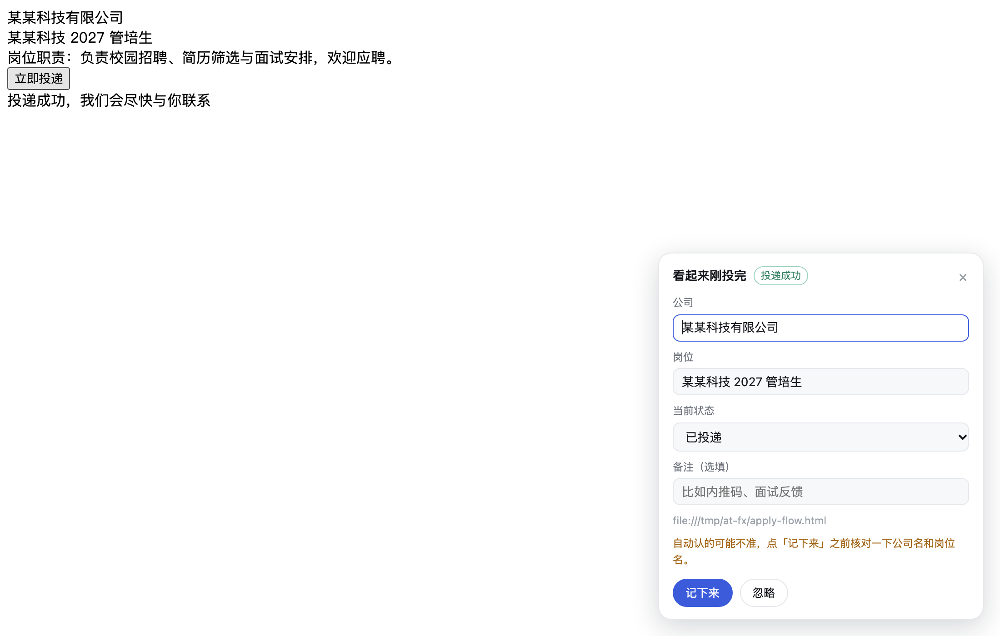

**它什么时候才会弹卡**，只有两种情况：

1. 你先点了「提交 / 投递 / 申请 / 报名」这类按钮，之后页面上冒出一句**事件性**的提示（"投递成功""申请提交成功""已成功提交申请！""Application submitted"…）；
2. 你落在了一个明确的**投递成功结果页**上（网址里带 `success` / `submitted` / `thank` 这类词）。

第 1 条认提示语分三层，越往后越宽，但都要求"这句话短"（≤80 字）：

- **词表**：常见写法一条条列出来（`SUCCESS_EVENTS`），命中就准；
- **语序无关的判据**：一句话里同时出现动作词（提交/投递/申请/报名/网申）和成功词（成功/完成/已提交/已收到），且不超过 80 字，就算数 —— mokahr 收尾只写「**已成功提交申请！**」，跟词表里任何一种语序都对不上，**这个语序漏掉过一次真实投递：卡片根本不弹，人以为是"识别不到"**；
- **整页跳转后的结果页正文**：有些站提交后浏览器整个换页，提示直接写在结果页正文里，之后不会再有 DOM 变动可抓。这种只在你点完提交、且离开不超过 25 秒时扫一次，而且只认词表里的说法（整页文字里"申请"和"成功"太容易凑齐，宽松判据在这里会误报）。

上面三层全都建立在"**盯 DOM 变动**"上，而它有个天生的盲区：**整页跳转过来的结果页上，那句提示是页面自带的、不是"刚冒出来"的** —— 一进来它就在那儿了，谁也等不到它的变动事件。所以页面加载时还会先跑一遍 `harvestExisting()`，把**已经写在页面上**的短提示块（只挑 2～200 字、子树不超过 40 个节点的）收进队列，再按上面三层判。有过一次真实漏记就是这么来的：智联的结果页写着「恭喜你已成功投递该企业！请继续作答测评」，这句话扩展完全看得见，但当时只有"等新冒出来的提示"那一条路，整条投递就漏了。加了这个初始扫描以后，同样的页面在回归里能稳定弹卡、并认出公司名。

"已投递"不算 —— 那是**状态**，不是动作。招聘网站上到处都有这种状态标签（尤其你已经投过的岗位，页面上会一直挂着"已投递"），拿它当"你刚投完了"就会误报：点进官网还没投就弹卡。同理，「我的投递记录」「投递进度」这类**入口**也不算。

同一次投递只弹一张卡：点了提交那一页弹过之后，跳到结果页再认出来也不会弹第二张（按"这一次提交"记，不按时间记 —— 否则同一网站上连投两家会被误挡）。


#### 投完了没弹卡？右边那颗「记一笔」

上面那套判据再怎么补，本质都是在"猜这句话算不算成功提示"——**站点换个说法就漏一次**。漏一次的真实代价是：投了一家很好的公司，事后完全不记得投过。所以扩展还有一条**完全不猜**的路：页面右侧常驻一颗竖排的「记一笔」标签，投完随手点一下，卡片立刻出来、公司和岗位已经预填好，两秒记上。

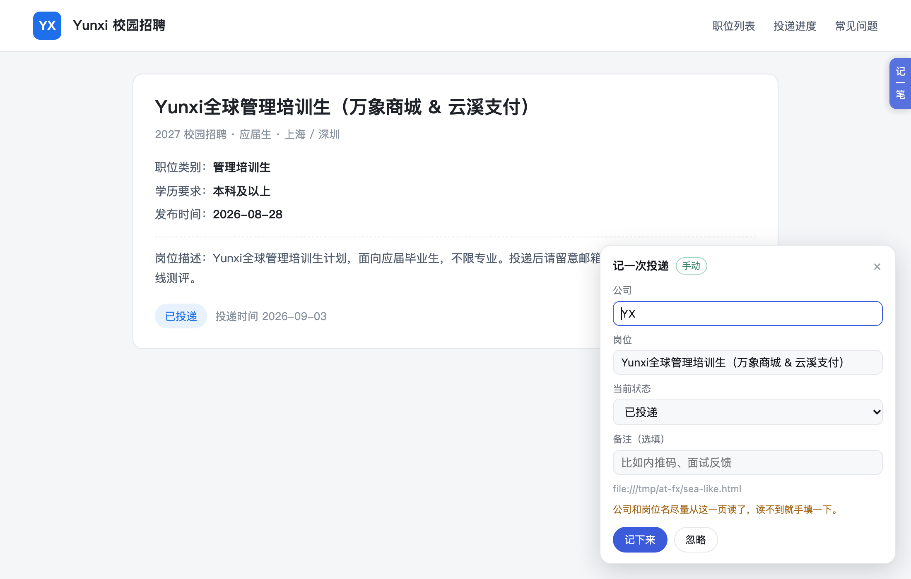

- 只在**看着像招聘页**、或者**你刚点过提交**的页面上出现，普通网页不会挂一颗在那儿；
- 位置可以上下拖着挪，挪过就记住；
- 鼠标移上去，右上角出现 `×`，点一下**这个站以后不出现**（按站点分别记）；
- 整个不想要：扩展弹窗里把「页面右侧常驻」的勾去掉；只是屏蔽过某些站的话，同一个弹窗里点「恢复被屏蔽的站点」就都回来了。

这样一共**三种记法**，按顺手的程度排：① 自动弹卡（正常情况，不用管）；② 右侧「记一笔」（自动识别漏了就点它，看一眼就能记）；③ 扩展图标 →「记录当前页」（连页面内容都不看，最稳但要点两下）。三条路写进的是同一张表，不会重复记。

公司名和岗位名认不准是常事（招聘 SPA 的标题经常是项目名），所以扩展认名字有**六条路**，依次试：

1. **拿你自己那份名单当字典，在整页文字里找**（最先试，也最准）：扩展把这一页的可见正文（最多 2500 字）发给本机服务，服务拿你的**投递记录 + 待投递清单 + 机会库**里的公司名去比对 —— 你自己收藏过、投过的公司名是最干净的词表，招聘站怎么改模板都绕不过去。比对有两条讲究：**长名字优先**（「长河发展银行」比「长河」可靠）；**两个字的短名字除非整页只命中它、否则只当候选不当结论**（这种名字太容易在正文里偶然撞上）。接口是 `POST /api/companies`（页面文字几千字，塞不进 GET 的 URL），认出来的结果顺带填进卡片的候选下拉，手动改名字时能直接选。服务没起时这条路自动跳过，不影响其它几条。实测在一个银行的结果页上一次命中，候选只有它一家。

2. **页面自己写着的「应聘单位 / 应聘职位」**：国聘、智联、51job、北森这类站会把公司和岗位成对摆在信息栏里 —— 页面上明写的字比 logo、比标题都可靠。扩展按**可见文字**按行扫，所以搜索框的历史下拉、隐藏的推荐位里出现的公司名抓不到（那些地方往往是别家公司：实测在国聘投华宇新能源，卡片一度被搜索下拉里的「万象商贸（北京）有限公司」填上）。

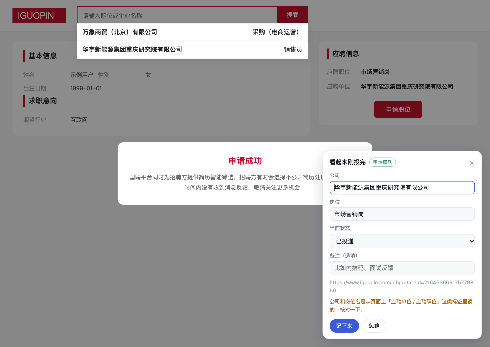

3. **你自己记录里反查**：把链接发回本机看板，去已有投递记录里找同一家公司的老链接，找到了直接用你以前填对的名字。判据是「同主机 + 同路径前缀」，另外还认链接里的**公司标识参数** —— 应届生求职网这类托管平台，岗位页 `/xyzjob` 和成功页 `/xyzsuccess` 路径完全不同，但那串 `ctmid` 一模一样，靠它才能认出是同一家。接口是 `GET /api/apply-guess?url=...`，单独也能调。
4. **成功页正文**：投递成功页上常写着「感谢您应聘**星桥科技**校招」「您的简历已发送至 …」，这是页面上唯一明说公司名的地方，直接抽出来。
5. **页头品牌区**：logo 图片的 `alt`、logo 旁边的文字。
6. **上一个页面见过**：成功页本身往往既没有公司全名也没有岗位名，但它通常是紧接着岗位详情页出现的。扩展会在岗位详情页把「公司 + 岗位」留在会话里（同一网站内跨页共享，3 小时内有效），成功页带过来。

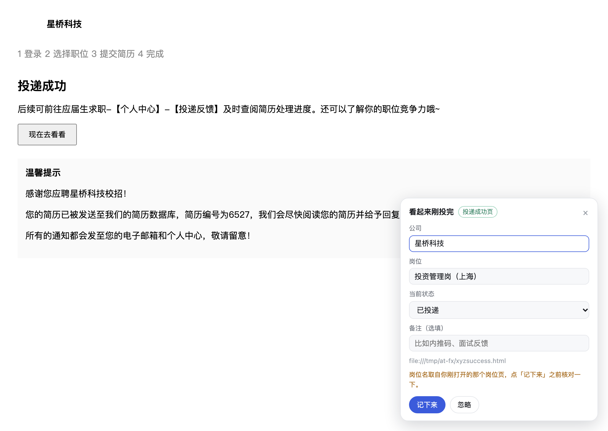

**填进去的值分两种，卡片上一眼能分出来**：

- 从上面第 1～4 条读到的（页面上真写着，或者你自己的名单里认出来的）—— 白底，提示写清来路，比如「公司名是在这一页的文字里认出来的（你自己记过这家）」；
- **靠猜的**（第 5、6 条，或历史记录兜底）—— 输入框是**黄框**，提示直说来源，比如「公司名来自历史记录 —— 这台网站你以前只记过「XX」这一家，是它吗？」。

六条路都没结果就**留空**，不瞎写。老版本会把「2027 Yunxi全球管理培训生计划」当公司名写进看板，现在这种名字进不来，宁可让你手填。

所以「第一次记一家新公司」最可能留空，你手填对一次以后，这家公司的其它页面（含成功页）就能自动认出来了。

弹卡上还是会提醒你核对一眼公司名和岗位名。如果某个站点老是误报，卡片底下有「这个网站以后别再自动弹」，或者在扩展弹窗里把「投完自动弹卡」整个关掉；右边那颗「记一笔」标签上也有个 `×` 可以按站点关掉。这两类屏蔽是分开存的（一个管自动弹卡、一个管标签），弹窗里那个「恢复被屏蔽的站点」两个一起清。

改了抓取逻辑要跑一遍回归。都是合成页面 + 夹具，**不碰你自己在用的浏览器**（只有 `popup-test` 里一项会拿真实招聘站压一遍）：

```bash
# 1) 起一个能连上调试端口的 Chrome / Edge（示例是 macOS 路径）
"/Applications/Google Chrome.app/Contents/MacOS/Google Chrome" \
  --user-data-dir=/tmp/at-test --remote-debugging-port=9222 --no-first-run &

# 2) 两套回归
BROWSER_URL=http://127.0.0.1:9222 node extension/test/extract-test.mjs   # 名字抽取，21 项
BROWSER_URL=http://127.0.0.1:9222 node extension/test/popup-test.mjs     # 弹卡时机 + 抽取，63 项

# 3) 想把 samples/ 里那几张扩展截图重出一遍（直接覆盖 samples/，共四张）
BROWSER_URL=http://127.0.0.1:9222 node extension/test/make-shots.mjs
```

需要 `puppeteer-core`（只负责连现成的浏览器，不会去下载 Chromium）：`npm i puppeteer-core`。

夹具都在 `extension/test/fixtures/`：`extract-test` 覆盖国聘式信息栏（含「下拉里挂着别家公司」的陷阱）、老站点的 logo + 类名、`公司名称：XX` 同一行、标签行重复出现（不许把「职位名称」当岗位名）、以及「页面上什么线索都没有」时历史兜底必须高亮；`popup-test` 覆盖「只打开页面写已投递」不许弹卡、真投完才弹、跨页记忆、结果页免点击、提示语序（`moka-apply.html`，照 mokahr 那种"类名全是构建哈希"的托管站搭）、整页跳转后的结果页（`apply-result-static.html`，正反两组对照）、智联式的静态结果页（`zhaopin-result.html`，考的就是"提示是页面自带的、不是刚冒出来的"能不能认出来 + 右侧标签在不在）、以及状态词不许误伤（`status-only.html`），还有备注那一格（⑰：卡片上必须有一格备注、**初始是空的**（不许预填、不许自动抓）、手填的能被原样带出去、不填时传的是空串而不是 `undefined`）。**夹具里的公司、岗位全是编的**，别换成真实企业；**夹具文件名也别带 `success` / `submitted` 这类字** —— 会被"结果页网址"那条规则认成成功页，不点也弹卡，用例就白测了。

回归脚本靠 `data-at="card"` / `data-at="fab"` 这两个标记找元素。**别改回"第一个带 shadowRoot 的元素"** —— 页面上现在有两个 shadow host（卡片、右侧标签），谁先谁后不定，这么找必抓错。

### 3.1 给看板页做体检（`tools/board-check.js`）

改了看板页（`applytracker.py` 里的 HTML / CSS / JS）之后跑这个，它连上**正在运行的**那个服务，按真实渲染量一遍：

```bash
BROWSER_URL=http://127.0.0.1:9222 node tools/board-check.js
```

它查十二类东西，一共 132 项，**全过才退出码 0**：

1. **计数口径** —— 右下角 `筛出 N 家（K 条岗位）` 里那个**家数**和 KPI「筛出公司」卡是不是同一个数（归并后一条记录不再等于一行，两个口径都要报）；默认开着的「还没截止」有没有被如实算成"有筛选在生效"
2. **筛选栏布局** —— 挂满 5 条条件（包含 2 条 + 不含 3 条），从 1440px 一路量到 740px，每一档都要求**无元素重叠、无内容挤压、无横向溢出**
3. **主要交互** —— KPI 卡点一下就筛选、排序按钮点亮、「最近新开」档位循环、条件行能加能删且只剩一条时不给删、分布面板点选再取消
4. **投递进度页** —— 同公司多岗位是不是真折成一组（**点这一行就能展开**、点小三角不会切两次、按钮能一键全开全收）、「总投递」跟概览 / 标签页 / 右下角计数是不是同一个口径（都按公司数）、备注还能不能就地编辑；**每一格还都能改**（公司名 / 岗位名 / 投递时间 / 链接点一下都进编辑态、带出原值，发出去的参数名一个不错，而且只打 `/api/status`）；**编辑浮层是浮在格子上面的**（五种格子逐个进编辑态，逐列量列宽 / 总宽 / 行高，一个数都不许变 —— 这类"进编辑态把表挤变形"的毛病只有真量才拦得住）；**投递时间那格**空着的时候点开就预填今天、浮层里带「今天 / 昨天 / 前天」三个快捷按钮，点一下直接存（只发一次 `/api/status`、体里只有 id + `applied_at`）
5. **配色切换** —— 默认「自动」是不是真没写死主题；切深色后**底色真的变深、字真的变浅**（只看属性等于没测）、主按钮换成深字、选择存进浏览器、刷新后还是深色**且是在首屏绘制前定下来的（不闪一屏浅色）**；系统偏好是深色时手动选浅色必须压得过去；配色条在 940~1440px 每一档都不挤不溢出
6. **邮箱页两个视图** —— 默认进的是「面试测评截止」、通知表回到 9 列（进度条那一列没长回来）；切过去「投递进度」真显示、前一个真收起（量渲染盒子的高度，不看 computed display —— 父级被 `display:none` 盖住时子元素自己的 display 照样是它本来的值，那种判据会让「两块都藏着」一路绿灯）；只停在测评阶段**且未止步**的整条不列（**挂掉的必须看得见**，不能被这条顺带藏掉）；按公司一家一行不重复；**活得走得最远在前、止步的整段压在最后**（段内也按走得远排 —— 这两条要分开量，拿整张表一路比下来会把「止步段开头那条」误判成倒挂）；灰块折叠 / 三档颜色 / 点灰块推进且**只写 `/api/interview`**、**点已经过的环节能退回来**（真发请求、`cur` 是点的那一格、提示语说的是「退回」）、页面上写着怎么点、「改」展开的编辑器铺满整行；**那排筛选**（搜索 / 按环节筛 / 按「已止步」筛 / 记住选择）真管用、环节标签按进度先后摆（不是字母序）；**一键「止步」只发 `stop`、不带 `nodes` / `cur`**，投递表标「已结束」的行只给说明、不给「继续」；**挂了的在进度条末尾挂一个红「已挂」标**（底色跟主题的 `--red` 一个色、实际不透明度是 1，没挂的一个都不许有 —— 祖先链的 opacity 一起乘进去才算数，父级淡一下就能把它抹掉）；980~1512px 每一档都不撑破
7. **页面自己发现「我这份代码过期了」** —— 页脚那行版本只在加载时渲染一次，所以后台升级了服务、你那个开着没关的标签页照旧跑老代码（表现就是「你改了？我怎么没看见」）。现在 /api/board 每次轮询都会带回服务端当前版本，页面拿它跟自己印的那一版比：对不上就在右下角亮出「看板已更新到 vX，点这里刷新」，并且**只要你没在敲东西**就自动刷一次（刷新前记住滚动位置、回来放回去）。体检里用打桩的 `verDoReload` 真跑一遍：闲着时自动刷**一次**（连着调两次也只排一次）、改着格子时**一次都不刷**（提示条留着等你停手）、版本对上后提示条自己收回去
8. **那排筛选 + 顶部精简** —— 筛选一件不少（搜索、类型标签、三个排序、隐藏已处理、只看没处理的、只看紧急的）还真管用（搜个不存在的词要筛成空表、清空要回来、「只看没处理的」真能把勾过处理的滤掉）；顶部只剩 3 个数字 + 1 块分布；**已经处理掉的通知不再报「过期 N 天」**；切换条在 1080 / 980px 不溢出
9. **机会库按公司归并** —— 主行公司名互不重复（一家一行）、**折叠态里分行一条没铺出来**、点一下组头摊开正好这么多行（带子行缩进的点）、再点收起；组头第二行有各分行 / 岗位的短名、前面有小三角；**点组头里的标签只筛不摊开**；计数两个口径齐全、跟 KPI 卡同一个数；**摊开后逐行对账**（每家跟的条数 = 它自己写的）+ **翻页不劈开一家**（先把筛选清掉，逐行扫两批：每家后面的记录条数都等于主行写的数）、1080 / 980px 不横向溢出
10. **投递进度表的「并入 / 拆出」** —— 折叠态下每一行（一家公司 / 一个主公司）都有且只有一颗按钮，标签只能是「并入」或「拆出」；按钮都在**最右那格、竖着排**，**把按钮藏起来再量一次**证明它没把「操作」列撑宽（这张表 1080px 下横向零余量，并排加两个字必然出滚动条）；点「并入」**只冒出浮层、不顺手把这家的岗位摊开**、表格宽度一个像素不动；浮层里预填「现在并给谁」（没并过就是空的）、候选是你表里现有的公司名、也能现打一个新的；填一个你表里没有的主公司名回车之后 —— 顶层多出主公司那行、被并那家从顶层消失、**顶层不出重名**、行数不变、概览「已归并子公司」+1、**主公司那行自己也带按钮**（主公司名打错了要能改挂）；**摊开全部时纯岗位子行一颗按钮都不给**（那是某家的一条记录，不是一家公司）；点开主公司那行，子公司子行写着是哪一家、那颗按钮是「拆出」；再点它、按「不并了」能拆干净回到原样；两次写请求体里**只有 `child` + `parent` 两个字段**（`parent` 空串 = 拆出来）；1080 / 980px 不横向溢出
11. **拖动并入**（合成的拖拽事件走一遍完整拖放）—— 能拖的就是「一家一行」的那些行（含主公司那行），**岗位子行一律不能拖**；拖起来源行淡下去、落点描一圈，拖到自己身上就不描且松手什么也不发生；松手**只发一次** `child` + `parent`、被拖那家从顶层消失；落点那家升成主公司行、**自动摊开**、自己还带按钮；概览「已归并子公司」+1 且右下角计数跟着变；**拖成环要拦住**（把主公司拖回它自己的子公司上 —— 拦住、一个请求都不发、两边都没被拖坏）；从那颗按钮上按下**不算拖**（编辑到一半不会被拖走）；拖动那会儿撞上 10 秒轮询**不许重建表格**（一重建这次拖动作废）；拖出来的那对，老路子照样拆得掉
12. **不碰你的数据** —— 全程把 POST / PUT 类写请求拦下来（返回假 `ok`），最后断言**一个记账类写请求都没发出去**（第 4 类那几下改格子、第 6 类那下推进 / 回退、第 10 类那两下并入 / 拆出、第 11 类的拖动与拆回是**故意**点的，按次数对账），同时页面零 JS 报错。⚠️ 这类"假响应"要**假装会落盘**：页面加载后若数据超过 45 秒没同步，`nudgeApps()` 会每 1.2 秒 `pull()` 一次、连拉 8 次，只回个 `{ok:true}` 的话刚改好的状态下一秒就被服务端的真值盖回去（详见 `tools/board-check.js` 里的注释）

> 第 1、3 类里那几条计数断言跟数据有关：拿 `tools/make-demo-data.py` 的演示数据跑，60 条机会刚好全都满足默认筛选，会假红 4 条。**要判断"是不是真坏了"，对着你自己的服务（8788）跑**，或者把筛出来的数跟屏幕上的数对一眼。

第 2 类是最容易漏的：这类"窄一点才露出来"的样式问题，在开发机的大屏上永远看不见。它踩过两次 —— `.qrow` 写 `min-width:0` 会被压得比内容还窄，删除钮横向溢出去盖住旁边那条；行内输入框的下限又被带 id 的全局规则`#pane-opps input[type=search]`盖掉（不带 id 的规则根本没生效），一行挂三条必然溢出。两处都已固化进自检和这个体检工具。

### 4. 接上邮箱通知（可选）

两种数据源，在 `config.ini` 的 `[notices]` 里选。

**A. 飞书多维表格（推荐）** —— 如果你已经有一套定时任务在往飞书表里写通知，别在本机再抓一次邮箱，直接读那张表：

```ini
[notices]
source = feishu
feishu_base_token = 网址里 /base/ 后面那段
feishu_table_id  = 网址里 ?table= 后面那段
feishu_profile   =        ; 用哪个飞书账号去读，留空 = 默认档案（lark-cli profile list 看有哪些）
feishu_ttl       = 300    ; 秒。lark-cli 一次调用 2~5 秒，看板 10 秒轮一次，靠这个节流
```

依赖本机的 `lark-cli`（飞书命令行）且已授权：

```bash
npm install -g @larksuite/cli --prefix ~/.workbuddy/binaries/node/cli-connector-packages
lark-cli auth login --recommend
```

拉下来的数据缓存在 `data/notices.csv`，飞书表那边有新记录，最多 5 分钟就出现在看板上。想立刻拉一次：

```bash
python3 applytracker.py --notices-sync
```

**B. 现成的 CSV** —— 任何一份列对得上的邮箱通知 CSV 都能用（`qqmail2table` 那种把邮箱通知写进表格的工具，产出的就算一份）。启动时看板会顺手去上一级目录找 `../qqmail-job-tracker/out/notifications.csv` 和 `../qqmail-job-tracker/data/notifications.csv`（正好有那套工具就自动接上），找不到也没关系 —— 在下面把路径写死就行：

```ini
[notices]
source = file
csv = /绝对路径/notifications.csv
```

`source` 留空或写 `auto` 时：配了飞书表就用飞书，没配就按 CSV 找。

没接上的话，看板的「邮箱通知」页会直接告诉你是哪一步没通。

**C. 手动补一条** —— 有些面试 / 测评是短信或电话来的，邮箱里根本没有。在「邮箱通知」页点右上角**「＋ 手动添加」**，公司名必填、其余可留空（截止时间默认「明天 23:59」，右边三颗快捷键一点就落值），保存后就跟邮件来的那些排在**同一个表**里、一起算截止。手动行只存本机 `data/notices_manual.json`，**不回写飞书**；公司名后面带一个「手动」小标签，鼠标划过这一行才浮出「删」，点两下确认才真删。

## 跟飞书表格里的投递进度保持同步（可选）

如果你习惯拿飞书多维表格记投递进度（投完改一次状态、进面了再改一次），可以把它接成看板的进度源：
**表里改了状态，看板过一会儿自己就变**，不用再导出导入。

```ini
# config.ini
[applications]
source            = feishu            # off 就退回纯本地
feishu_base_token = 网址里 /base/ 后面那一段
feishu_table_id   = 网址里 ?table= 后面那一段
feishu_profile    =                   # 装了多个 lark-cli 账号档案才要填
feishu_ttl        = 1800              # 多久去核对一次（秒），30 分钟足够
```

配好之后什么都不用做：服务开着就一直盯着，过期就自己去拉；页面右下角那张「投递进度」页的工具栏上也有一个
**「同步飞书进度」**按钮，想立刻拉一次就点它。命令行同样能拉：

```bash
python3 applytracker.py --apps-sync    # 立刻同步一次，并把改了什么列出来
```

**不想等那 30 分钟？不用管 —— 打开页面 / 从别的标签切回来时会顺手帮你拉一次。**
投递端是实时的（扩展一提交就写进飞书表），但这边是按 `feishu_ttl` 定时核对的，
所以「刚投完就切过来看」原本会看不到那一条，看着像没记上。现在的规则是：**页面一露面，
发现数据超过 45 秒没同步过，就顺手拉一次**（45 秒内刚拉过就不重复拉，别让 `lark-cli` 空转）。
拉回来如果有新记录，右下角会直接报一句「同步进来 1 条投递记录：××公司」，不用在表里翻。

点完之后状态栏会写清楚这次拉回来多少、改了哪几条：

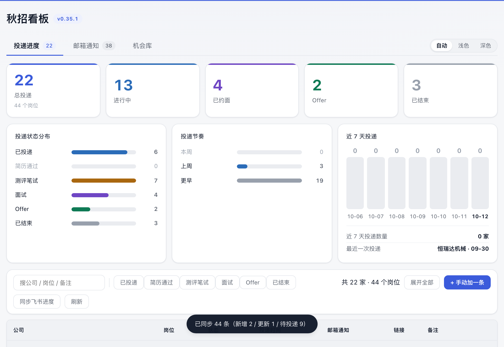

**两边都改过怎么办**（这是这类同步最容易翻车的地方）：飞书那一格的值会原样抄一份进本地记录的
`飞书状态` 列，下次同步时对一下就知道了：

- **飞书那格变了** → 以飞书为准，状态、投递时间、备注一起跟上
- **飞书那格没变** → 你在看板上手改的状态保留，不会被按回去

另外，**飞书表里没有的本地记录不会被抹掉**：浏览器扩展新记的那条、你手动加的那条，都原样留着 ——
同步只是把飞书那边的变化推进来，不是拿飞书覆盖本地。

几件它替你处理好的事：

- **状态不用你迁就**：表里写「待测评 / 待一面 / 已AI面 / OC! / 已放弃」都能认，自动翻成看板那 6 个标准状态（认不出来的兜到「已投递」，宁可宽松也别悄悄丢一条）
- **「未投递」「想投」这类不算投递**：混进去会把总投递数和「我投过的公司」算多，所以单独存到 `data/待投递.csv`，不动主表
- **公司名空着的行不瞎猜**：表里确实有这种行（只写了岗位和链接）。猜错的公司名会串到机会库的「我投过的公司」匹配里去，所以统一记成「未填公司」，备注里带上链接标题，你打开看板一眼就能看出该补哪条
- **链接和日期都清洗过**：`[标题](url)` 只留 URL；那一列要是被写成岗位名（不是网址）就当没有链接，免得页面上出现点不动的死链。日期统一成 `YYYY-MM-DD HH:MM`，**原表没写时间的就留空**（显示「—」，排在最后），不拿同步那一刻顶上，否则「本周投了几家」会凭空多出来
- **备注带上轮次**：表里那些「笔试 / AI面 / 一面 / 二面 / HR面」的日期，和备注、内推码拼在一起写进备注列
- **认得出同一家**：先按「公司 + 岗位」配，配不上再按链接配，最后放宽到「公司去掉『有限公司』后缀 + 岗位去掉空格」。所以你在表里把岗位名改长了，也不会在看板上多出一条重复的
- **拉不动不会留坑**：飞书偶发断连（`EOF`）时会自己退避重试三次；真失败了页面上如实写一行，并保留本地那份，10 分钟后自己再试，不会把表清空

> 只想导一次、不想一直同步？把 `source` 设成 `off`，然后跑 `python3 applytracker.py --import-apps` ——
> 那是老的一次性导入，按「公司 + 岗位」判重，导过的不再导，也不会覆盖你看板上改过的状态。

## 手动记一条

扩展认不出来的站点（跳转式、弹窗式、要扫码的），三条路，从轻到重：

**① 在招聘页上当场记**：点页面右边的「记一笔」标签（或者扩展图标 →「记录当前页」）。卡片会尽量把这一页的链接、公司、岗位带过来，看一眼点「记下来」就行，不用离开页面。

**② 在看板上补**：点「＋ 手动加一条」，填公司名就行，其余可以留空。

**③ 命令行**：

```bash
python3 applytracker.py --add --company "某某公司" --position "市场营销岗" \
  --url "https://..." --status 已投递 --note "内推码 XXX"
```

`--status` 可选：`已投递` / `简历通过` / `测评笔试` / `面试` / `Offer` / `已结束`。

## 其他命令

```bash
python3 applytracker.py --list           # 终端里列出所有投递记录
python3 applytracker.py --notices-sync   # 立刻从飞书拉一次邮箱通知
python3 applytracker.py --opps-sync      # 立刻全量同步一次机会库（表很大，一分钟上下）
python3 applytracker.py --apps-sync      # 立刻同步一次投递进度（表里改了状态，看板跟着变）
python3 applytracker.py --import-apps    # 老的一次性导入：只往里加，不更新已有记录
python3 applytracker.py --report         # 生成一个单文件离线看板（数据固化在网页里，可直接发给别人看）
python3 applytracker.py --self-test      # 自检
python3 applytracker.py --port 9000      # 换端口
python3 applytracker.py --base /tmp/at-demo --config /tmp/at-demo/config.ini   # 换数据根目录 + 配置
```

`--base` 是给「拿另一份数据跑一遍」用的（比如 `tools/make-demo-data.py` 造的脱敏演示数据）：
`config.ini` 里的相对路径都相对它解析，**而且那个目录里的 `config.ini` 优先**（连当前目录那份一起压过）
—— 只 `cd` 过去是不管用的。

**`--config` 一起写上更稳**：万一 `--base` 那个目录里没有 `config.ini`，配置会退回当前目录那份，
而在仓库目录里跑的时候，那份配置带的是**真实飞书 token** —— 2026-10-02 就这么让演示服务把真实
投递记录同步进了演示目录，真实公司名进了截图。两个参数都给，才没有这条退路。

换端口的话，扩展那边也要跟着改：`extension/background.js` 顶部的 `DEFAULT_PORT`，改完到扩展页面点一下刷新。或者直接在扩展弹窗里填地址。

## 文件都在哪

```
data/applications.csv     投递记录，主数据。Excel / WPS 直接能打开改
data/待投递.csv           「收藏了但还没投」清单（同步飞书表时自动生成），不参与投递统计
data/.apps_sync.json      上次跟飞书同步投递进度的时间，删掉只会让它下次启动多拉一次
data/notices.csv          邮箱通知的本地缓存（只有飞书数据源才会自动生成，别手改，同步会覆盖）
data/notice_states.json   你在看板上手动标的处理状态（飞书同步不会覆盖它，删掉就等于全部还原）
data/notices_manual.json  你在「邮箱通知」页手动补的通知（短信 / 电话来的那些，只存本机、不回写飞书，只在你补过才会有这个文件）
data/interview_progress.json  你在「面试进度」里手改过的环节 / 当前轮次 / 止步（只在你动过手才会有这个文件，删掉就回到按邮件自动推断）
data/app_renames.json     你在看板上改过公司名 / 岗位名的那些记录的**曾用名**（同步靠它认出是同一条，只在你改过名才会有这个文件，删掉的后果是下次同步可能多出一条重复记录）
data/app_parents.json     你在投递进度表里点「并入」记下的**子公司 → 主公司**（只在你点过「并入」才会有这个文件，删掉就全部散回一行一家。内置打底那条 `TCL实业 → TCL` 不在这里，它写在程序里）
data/opportunities.json   机会库缓存（全量同步下来的那张汇总表，删掉会重新拉）
data/.scratch/            拉飞书表时的临时落盘目录，固定文件名，每次覆盖，可以不理会
config.ini                你的配置（已被 .gitignore 忽略）
start.command             macOS 双击起看板（已在后台跑的话就直接开浏览器）
start.bat                 Windows 双击起看板
开机自启.command          macOS 双击装开机自启（自己探测路径、写 plist、注册进系统）
关闭开机自启.command      macOS 双击取消自启
extension/                浏览器扩展，装的时候选这个目录
extension/test/           抓取逻辑的离线回归（合成页面 + 夹具）+ 重出截图的脚本，改抓取后跑一遍
tools/                    造演示数据、重出看板截图的脚本；外加 tools/board-check.js（看板页体检，改了看板页就跑它）
samples/                  截图、样例 CSV、离线看板样例 —— 里面的公司、岗位、邮件通知**全是编造的演示数据**
```

`samples/` 里的每一个字都是虚构的：公司名（星桥科技、云溪智能…）、岗位、邮件主题、链接，
没有一个来自真实企业或真人。这套数据由 `tools/make-demo-data.py` 生成（固定随机种子，可复现），
截图由 `tools/make-screenshots.js` 对着这份演示数据重拍。重拍的三步：

```bash
python3 tools/make-demo-data.py                                   # 1) 造脱敏数据（默认 /tmp/at-demo）
python3 applytracker.py --serve --no-open --port 8790 \
  --base /tmp/at-demo --config /tmp/at-demo/config.ini            # 2) 起演示服务
DEMO_DIR=/tmp/at-demo BROWSER_URL=http://127.0.0.1:9444 BASE=http://127.0.0.1:8790 \
  node tools/make-screenshots.js                                  # 3) 出图（会先自检数据脱敏）
python3 applytracker.py --report --base /tmp/at-demo --config /tmp/at-demo/config.ini
cp /tmp/at-demo/data/看板.html samples/看板样例.html               # 4) 顺带刷新离线样例
```

**`--base` 和 `--config` 那两步别省**，这里一天踩过两次同一个坑：
① `config.ini` 里的相对路径（`data/…`）是按 **`applytracker.py` 所在目录**解析的，不是当前工作目录 ——
只 `cd` 到演示目录没用，读到的还是仓库里那份真实数据；
② 光给 `--base` 也不够：当时人就在仓库目录里，仓库那份 `config.ini`（`[applications] source = feishu`，
带真实 token）会被读到，于是演示服务把**真实投递记录同步进了演示目录**。
两次都让真实公司名进过截图（都没提交，发现后已还原）。

现在有三道防线：`--base` 目录里的 `config.ini` 优先于当前目录那份；演示配置里三个数据源全是本地的
（`applications` / `opportunities` 都写 `off`）；`make-screenshots.js` 出图前会验一遍 ——
**页面上出现的公司名必须全都来自演示数据**（`DEMO_DIR` 指到演示目录，读它的 CSV 当名单），
只要有一家不在名单里就中止、**一个文件都不写**（这条实测拦得住：故意给错名单时会报
「有 N 家公司不在演示名单里」并退出）。往仓库里放图前也请顺手扫一眼图里的公司名 —— 真名一律不该出现。

`samples/看板样例.html` 可以直接双击打开，看看长什么样。它是**自包含**的：页面里嵌了一屏机会库快照
（60 条），所以**离线也能点着筛、搜着看**，只是范围限于这 60 条；页脚会写明这是离线样例。

投递记录的 CSV 字段：`id, 公司名称, 岗位名称, 状态, 飞书状态, 投递时间, 网页链接, 来源, 备注, 更新时间`。
其中 `飞书状态` 存的是飞书表那一格的原文（如「待一面」），用来判断「是飞书那边动过、还是你在看板上手改的」；
只用了本地那份、没接飞书的话它一直是空的。字段长什么样可以直接看 `samples/投递记录样例.csv`（12 行虚构数据）。

换电脑就是把 `data/applications.csv` 拷过去。想多端同步，把这个文件放进你的网盘同步目录，`config.ini` 里改 `applications_csv` 指过去即可。

## 常见问题

**看板上改的状态过一会儿又变回去了？** 多半是飞书那边刚改过同一条 —— 规则是「飞书那一格变了就听飞书的」。反过来说，飞书没动过的记录，你在看板上手改的状态会一直保留。想彻底不跟飞书同步，把 `[applications] source` 改成 `off`；只在本地留一份也行。

**工具栏点「同步飞书进度」提示失败？** 飞书接口偶发断连（`EOF` / `connection reset`）很常见，代码里会自己退避重试三次（2s / 5s / 10s）；仍然失败一般是网络或授权问题，页面会把原因写清楚。**看板不会因此清空**，本地那份照常用，10 分钟后会自己再试。想看详细报错：`python3 applytracker.py --apps-sync`。

**扩展没反应？** 先看点开扩展弹窗，那里会显示服务有没有连上。没连上就是看板没起，或者端口跟 `DEFAULT_PORT` 对不上。

**弹卡片太频繁？** 只在两种情况弹：① 你点了提交/投递类按钮、页面上又冒出成功提示；② 落在投递成功结果页。真遇到误判，卡片底下点「这个网站以后别再自动弹」，或者在扩展弹窗里把「投完自动弹卡」关掉。要调词表就改 `extension/content.js` 顶部的 `SUCCESS_EVENTS`（认哪些成功提示）、`looksLikeSuccessText` 里的 `OK_ACTION` / `OK_DONE` / `OK_STOP`（语序无关的判据和它的排除项）、`SUCCESS_URL_SEG`（认哪些结果页网址）。`SKIP_HOSTS` 是永不打扰的站点名单，`ALLOW_HOSTS` 是**从这份名单里捞出来的例外**（整域跳过会把整站都关掉，平台自己旗下的招聘官网得单独放行）。

**右边那颗蓝色的「记一笔」标签能去掉吗？** 能，三个层次：点它右上角的 `×` → 这个站不再出现；扩展弹窗里去掉「页面右侧常驻」的勾 → 全都不出现；只是屏蔽过几个站的话，弹窗里点「恢复被屏蔽的站点」就都回来了。它跟自动弹卡是两个独立开关，关掉哪个都不影响另一个。

**投完了但卡片没弹？** 按这个顺序查：

1. 刷新一下页面 —— 扩展是"已解压加载"的，改了 `content.js` 要重新加载页面才生效；
2. 看那个站的成功提示是怎么写的。实测踩过的坑：mokahr 写「**已成功提交申请！**」，跟词表里「提交成功 / 申请成功」的语序都对不上。现在这种语序由 `looksLikeSuccessText` 兜住了，再遇到新写法往 `SUCCESS_EVENTS` 里加一条、或者看看是不是被 `OK_STOP` 当成了状态词；
3. 是不是**整页跳转**去了结果页、而网址里又没有 `success` 这类词？这种靠 sessionStorage 把"刚点过提交"带过去，窗口只有 25 秒，中间要是绕了别的页面就跟丢了；
4. 那个站是不是**某个平台托管的企业招聘官网**？这类域名常常整个挂在平台主域下面（飞书招聘的校招官网就是 `<企业代号>.jobs.feishu.cn`），主域要是不小心进了 `SKIP_HOSTS`，整站会被一起跳过 —— 自动弹卡、「记一笔」、图标记录三条路同时哑掉。修法是把招聘官网那个子域加进 `ALLOW_HOSTS`（例外优先于跳过），回归里有对照用例钉着；
5. 那个站提示写得完全认不出（比如「恭喜你已成功投递该企业」这种，得靠"初始扫描 + 语序判据"两样凑齐才认得出）？**点页面右边的「记一笔」**，两秒记上，别跟它较劲；
6. 连「记一笔」都没有（不像是招聘页、又没点过提交）？点扩展图标 →「记录当前页」，标题写「记一次投递」，完全不看页面内容。

**刚打开官网、还没投就弹卡了？** 那是老版本（扩展 0.1.0 及以前）的毛病：它把页面上的「已投递」**状态标签**当成了投递**动作**。逻辑已经改成"先点过提交按钮才算数"，刷新扩展后用 0.2.0 起就不会了。

**记录里的公司名是错的 / 留空了？** 认名字一共六条路（见上面「正常投简历」那节），第一条也是最先试的一条是**拿你自己名单里的公司名当字典**——它需要本机服务开着（`POST /api/companies`），服务没起就自动跳过，退回后面几条。六条都没结果才留空让你手填，所以**第一次**记一家新公司时最可能留空；你自己填对一次以后，这家公司的其它页面就能自动认出来了。要调规则就改 `extension/content.js` 里的 `companyStrict` / `companyFromSuccessText` / `companyFromBrand`，字典那侧在 `applytracker.py` 的 `pick_company_hit()`。

**端口被占？** 不用管，服务自己会在 8788–8791 里挑一个空的上，并在黑窗口打印实际端口（浏览器扩展也会自己找过去）。
只有**你想指定某个端口**时才用 `--port`；注意这种情况服务**只在你要的那个端口上试一次**，被占就报错、不会自己漂到别的端口。

**投记录要不要点两次？** 不用。扩展 POST 到本地服务，服务直接落盘到 CSV，看板每 10 秒自己拉一次。

**邮箱通知那页是空的 / 写着同步失败？** 先跑 `python3 applytracker.py --notices-sync`，报错信息会直接告诉你是哪一步：`lark-cli` 没装、没授权（`needs_refresh`）、还是 base_token / table_id 写错了。同步失败时看板会退回显示上一次成功同步的数据，不会变空。

**在飞书那边记的投递，看板上一直不出现？** 先确认服务是不是开机自启的（launchd 挂的那个）。这种"**从终端跑一切正常、挂上自启之后就不动了**"的情况，八成是 launchd 的环境比登录 shell 干净：`lark-cli` 是 Node 脚本，PATH 里没有 node 就直接 `env: node: No such file or directory`，于是同步**一直失败但不会崩**——页面看着哪儿都好，只是数据不更新。2026-10-02 踩过一次，症状是"我明明在飞书那边记了，看板上根本没有"，实际是 node 升级换了目录、plist 里那行路径过期了。现在代码里自己兜了一层（见上一节）。自己排查看这个日志，原因会写在里面：

```bash
tail -20 ~/Library/Logs/applytracker.out.log
# ✗ 飞书通知同步失败：lark-cli 退出码 127：env: node: No such file or directory
```

顺带一提，"邮箱通知"那页的同步状态也会把同一句话显示出来（只是很容易被当成网络抖动忽略掉）。

**「逾期未处理」的数跟我数的不一样？** 这条只统计**还没处理**的通知：截止时间过了、而且处理状态还是「待处理」的才算。已经标成「已完成 / 已过期 / 已忽略」的都不计入——做完的事不该在待办里催你。想改口径就在表格里改「处理」那一列。

**手动标的状态会被飞书同步冲掉吗？** 不会。看板上标的存本地 `data/notice_states.json`，同步只覆盖 `data/notices.csv`。要撤销就选下拉里的「（清除我的标记）」，或者直接删掉那个 json 文件。

**机会库同步到一半断了？** 没白拉。进度落在 `data/.opps_progress.json`，再跑一次 `--opps-sync` 会接着往下拉；拉完整张表才会覆盖 `data/opportunities.json`。中途失败时看板会提示「同步失败」，但显示的仍是上一次同步下来的完整数据，不会变空。

**为什么一家银行只占一行、点数却对不上？** 源表把一家公司拆成很多条（邮储 30 多个「XX 省/市分行」各一条），列表**按公司并过**了，所以「有个几千条」的源表并完只剩几千家。右下角的计数因此报两个数：`筛出 N 家（K 条岗位）` —— N 是你一行一行数得出来的公司数，K 是这些公司底下的记录条数。归并规则是「**只对以「分行 / 分公司 / 营业部 / 支行 / 总行…」结尾的名字动手**，切在最后一个主体词（银行 / 期货 / 证券 / 有限公司…）后面」，宁可漏并不误并：`招商银行信用卡`、`中国农业银行研发中心` 这类子品牌、内设机构都留在外面各占一行。抽不出共同主体的（不同集团下的电厂之类）也不硬并。

**一家公司底下有几条，怎么看？** 主行写着「N 个分行 / N 个岗位」，第二行是它们的短名；**点这一行就摊开**（不用去点那个小三角），再点收起。地点列是这家全部分行合并去重的，截止时间取**最近的一个还没过期的** —— 先投这个。

**机会库里的「招满为止」为什么排最后？** 截止时间是那张表里手写的文本，有的写具体日期、有的写「尽快投递 / 招满为止」。能认出日期的按日期排，认不出的一律当"长期有效"沉到最后，也不会被算成已截止。

**电脑开着、但没打开看板页面，机会库会更新吗？** 会。服务进程里有个后台看门狗线程，只要**服务还在跑**，超过 6 小时没同步就自己去拉一次飞书，不需要点开任何标签页。所以真正的前提不是"电脑开着"，而是"**那个跑服务的窗口还开着**"——关掉它（Ctrl+C 或关终端）之后就不再自动同步了；想让它开机就在，把 `start.command` 加进「登录项」。随时想拉最新，点页面上的「检查更新」或跑 `--opps-sync` 都行。

**同步失败了会怎样？** 不会变空（显示上一次同步下来的完整数据），也不会傻等 6 小时——失败后 10 分钟就允许重试，看门狗下一轮会再试一次。断在半路也没白拉，续传进度在 `data/.opps_progress.json`。

## 隐私

- 投递记录只存在你自己电脑上，服务只监听 `127.0.0.1`，同一局域网里的别人也访问不到
- 扩展只在你点开招聘网站时工作，不会把浏览记录发给任何地方。为了在你自己那份公司名单里认公司名，弹卡之前会把**当前这一页的可见文字（最多 2500 字）**发给你本机的服务（`POST /api/companies`）—— 这些文字只在内存里做比对，**不落盘、不出网**。真正记下来的那一条，只在你点「记下来」时才发出去
- 只有一条出网的路径：选了飞书数据源时，服务会去读你自己那张飞书多维表格（用本机 `lark-cli` 已授权的身份）。不想联网就把 `source` 改回 `file` 读本地 CSV
- 除了读你自己那张表，没有任何数据发往任何第三方

## License

MIT
